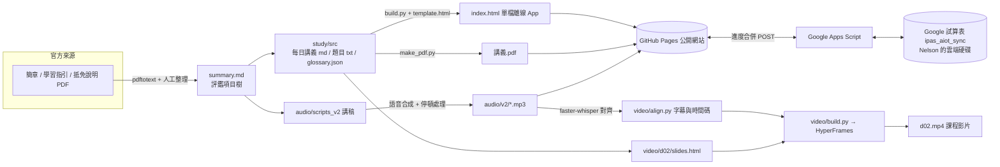

# iPAS AIoT應用工程師（初級）學習平台 開發歷程

> 案例紀錄：一位備考者（Nelson Chen）與 AI 學習助理「考試學習助教」協作，在約三天內從零建出一套對應官方考試範圍的學習平台。
> 紀錄期間：2026-10-18 ～ 2026-10-20。所有時間皆為台北時間（UTC+8）。
> 本文內容依據對話紀錄與兩個 git 儲存庫的提交紀錄整理；數字均取自實際產出物或紀錄，未經推估。

---

## 0. 一頁摘要

| 項目 | 內容 |
|---|---|
| 目標考試 | iPAS 經濟部產業人才能力鑑定「AIoT應用工程師」初級學科，2026-10-31（週六） |
| 應考科目 | 考科一【AIoT基礎概論】09:00–10:15；考科二【物聯網系統與應用】10:45–12:00；皆為單選題、電腦化測驗 |
| 學習條件 | 每天 30 分鐘，約兩週 |
| 主要產出 | 13 天單元的離線單檔學習網頁（241 題、484 個名詞、36 題隨堂小測）、169 頁講義 PDF、13 集有聲教材、跨裝置雲端同步、D2 試作課程影片 |
| 上線網址 | https://collective353bot.github.io/ipas-aiot-study/ |
| 儲存庫 | 專案（私人）`collective353bot/ipas-aiot-project`；網站（公開）`collective353bot/ipas-aiot-study` |

---

## 1. 背景與需求起點

Nelson 想報考 iPAS AIoT應用工程師初級，考試日為 10/31，每天能撥出約 30 分鐘。他一開始請考試學習助教「研究考這個需要準備什麼」，之後隨著使用逐步提出新需求。整個過程有三個貫穿全程的要求：

1. **範圍要對**：「你給我的重點跟內容你要很確定是考試範圍跟實際的對應內容」。
2. **每天要有感**：「我每天都要可以有感受到進度 最好是每天都有學習 跟 驗證 而且不是只給我幾個重點而已吧」。
3. **少來回、多自主**：他問過「合作是不是只能靠傳訊息」，希望更有效率；也明確授權「那你可以部署到那邊 你可以自己自主完成的」。

---

## 2. 時間軸

### 2026-10-18（六）：範圍研究 → 學習網頁上線 → 有聲教材 v1

**他的要求**
- 研究 iPAS AIoT應用工程師初級需要準備什麼；每天 30 分鐘、10/31 考試。
- 確認考科：考科一 AIoT基礎概論 ＋ 考科二 物聯網系統與應用。
- 第一版回覆後他直接退件：「不太對 我是要你給我一個很好的計劃跟複習內容 我每天都要可以有感受到進度 最好是每天都有學習 跟 驗證 而且不是只給我幾個重點而已吧」，並要求「你給我的重點跟內容你要很確定是考試範圍跟實際的對應內容」。

**做了什麼**
- **官方範圍研究**：從 iPAS 官網下載 115 年度簡章（115.V2、115.V1）、114 年舊制簡章、科目抵免說明、考區安排說明，以及官方《學習指引－科目1 AIoT基礎概論》（156 頁），轉成文字後整理成 `summary.md`，拆出官方「評鑑主題／評鑑內容」樹狀結構（考科一 1.1～3.2、考科二 1-1～2-3，共 15 個評鑑項目）。無法從官方文件確認的事項標「⚠️未確認」，例如 115 年簡章未載明題數（舊制為 50 題）。
- **學習網頁**：以 `study/build.py` ＋ `template.html` 把 `study/src/` 的 markdown 講義與題目檔編譯成一個**單檔、可離線**的 HTML（`index.html`），進度存在瀏覽器 localStorage。
  - 13 天單元（D1–D5 考科一學習、D6/D7 考科一模擬考、D8–D11 考科二學習、D12 考科二模擬考、D13 總複習）。
  - 題庫 241 題：一般學習日每天 12 題；模擬考 D6 40 題、D7 40 題、D12 41 題。
  - **每一段講義與每一題都標註官方評鑑項目代碼**（如「考科一 1.1｜指引 p.3-2」），並附「官方範圍對照表」。
  - 約 80 題改編自官方學習指引的練習評量，其餘為原創，均明確標示**非考古題**。
  - 官方學習指引有數題答案與解析互相矛盾（如 5.2 第 5、7、8 題），講義已更正並以 ⚠️ 標示。
  - 考科二沒有官方學習指引，內容依簡章的評鑑內容與能力指標逐條對應，一般技術補充標「補充」。
  - 同步產出 128 頁的 `講義.pdf`。
- **每日提醒**：他說「好，每天晚上 8 點提醒我」→ 設定每晚 20:00 讀書提醒。
- **自主部署**（19:13）：依他「可以自己自主完成」的授權，用 gh CLI 建立公開的網站 repo，並開啟 GitHub Pages。
- **有聲教材 v1**（22:05）：他問「你可以做成有聲教材嗎」→ 為 13 天各寫一份講稿（`audio/scripts/`），以 edge-tts（zh-TW-HsiaoChenNeural）合成，網站加上播放器、倍速與續播。

### 2026-10-18 晚 ～ 10-19：計畫順延、聲音升級、版本控管

**他的要求**
- 「抱歉今天沒開始 可以整個往後推延一天嗎」
- 希望聲音更自然，想用 Higgsfield 平台的語音模型，並想知道每 10 分鐘的成本。
- 試聽後選定 ElevenLabs v4 的 Hana 聲音，但要求**先重新思考講稿**，多一些例子、更生動。
- 傳了一張截圖，再次確認兩個考科。
- 要求把專案存進 git；第一次排除了 mp3，他說「mp3可以一起放的吧」。

**做了什麼**
- **計畫整體順延一天**：D1 改為 10/19，D12 考科二模擬考移到 10/30，D13 改為「10/30 晚上與考試當天早上聽的總複習音檔」。
- **語音方案比價**（每 10 分鐘估算 credits）：

  | 模型 | 每 10 分鐘約 | 備註 |
  |---|---|---|
  | Qwen | 1.3 | 最便宜 |
  | MiniMax | 9 | |
  | ElevenLabs | 9 | |
  | ElevenLabs v4 | 14 | 最後選用 |
  | Seed | 20 | 單次上限 2,048 字 |

  另製作三種模型各約 1 分鐘的試聽樣本（`audio/samples/`）供他比較。
- **講稿 v2**：在官方範圍內重寫 13 份講稿（`audio/scripts_v2/`），加入更多生活／工廠例子、口訣與考題陷阱。
- **錄製 v2**：13 集，總計 209.99 credits。各集長度：

  | 集 | 長度 | 集 | 長度 | 集 | 長度 |
  |---|---|---|---|---|---|
  | D1 | 15:12 | D6 | 7:39 | D11 | 10:33 |
  | D2 | 13:27 | D7 | 7:49 | D12 | 7:43 |
  | D3 | 12:07 | D8 | 10:40 | D13 | 9:37 |
  | D4 | 11:40 | D9 | 11:31 | | |
  | D5 | 11:59 | D10 | 9:37 | | |

- **問題：隨堂提問後的停頓位置不準**。講稿中的提問需要留 4 秒思考時間，自動判斷停頓位置在 6 集不可靠 → 改為逐集人工指定切點後插入 4 秒靜音（`audio/v2/process.py`、`verify.py`）。
- **網站更新**（10:19）：播放器改讀 v2 音檔，新增集數清單頁 `#/audio`；音檔網址加 `?v=2` 避免瀏覽器快取舊版。上線後截圖驗證（10:21）。
- **版本控管**（09:58）：建立私人專案 repo（含 README、.gitignore）。原先 .gitignore 排除 mp3，依他的意見改為一併納入（09:59）。
- **問題：git 推送認證失敗** → 以 `gh auth setup-git` 讓 git 使用 gh 的登入憑證後解決。

### 2026-10-19 晚：固定播放器、名詞小辭典、隨堂小測

**他的要求**
- 「卷動後讓播放器可以fixed在某個地方」
- 他表明自己是硬體初學者，並分享為了看懂講義，還得另外去問其他 AI 工具的問答（AOI/CNN、門控結構、MCU、HMI/MES/SCADA、NPU/FPGA 等）。他希望：章末有名詞解釋、網站上也有、滑鼠移過去就能看到；章節中間加練習題，且**不要跟章末題目重複**。

**做了什麼**
- **固定播放器**（23:12）：捲動時播放器黏在導覽列下方，並在 390px 手機寬度下驗證。
- **名詞小辭典**（23:38）：
  - `glossary.json` 收錄 **484 個名詞**，每個都有白話解釋、例子與「易混淆」提醒。
  - 講義內的名詞自動加上提示框：桌機滑鼠移過、手機點一下即顯示；每段只標第一次出現、採最長字串比對，並略過程式碼、標題、連結與選項文字，避免干擾作答。
  - 同名異義的縮寫（如 TPM、PSK）依該段的評鑑項目代碼判斷要顯示哪個意思。
  - 每天講義末尾有可收合的「名詞小辭典」，另有可搜尋的總辭典頁 `#/glossary`。
- **隨堂小測 36 題**：D1 4、D2 3、D3 4、D4 4、D5 4、D8 4、D9 4、D10 4、D11 3、D13 2（模擬考日不加）。標示為「原創練習」而非考古題（iPAS 不公開歷屆試題）。
- **避免重複**：撰寫 `check_dup.py` 比對每題隨堂小測與 241 題題庫的文字相似度，最高僅 0.53，確認沒有換湯不換藥的重複題。
- 講義 PDF 加入名詞附錄，頁數由 128 頁增至 **169 頁**。
- **問題：部署卡住**。GitHub Pages 的建置整晚停在排隊狀態；10/20 清晨工作環境又一度斷網。網路恢復後於 10/20 約 06:57 重新部署，並實際開啟網站確認已上線。

### 2026-10-20（二）上午：跨裝置雲端同步

**他的要求**
- 在手機（加到主畫面的 PWA）上看到進度是 0。
- 希望能自動同步，並問後端要放在哪裡；選擇「存在我的 Google 雲端」。

**做了什麼**
- **說明原因**：進度存在各瀏覽器自己的 localStorage；iOS 加到主畫面的 PWA 與 Safari 使用不同的儲存空間，所以電腦上的進度不會出現在手機上。
- **方案**：Google Apps Script 網頁應用程式 ＋ 他自己雲端硬碟裡的 Google 試算表 `ipas_aiot_sync`。
  - 以共用密鑰保護；設定連結把密鑰放在網址 `#` 之後（不會傳到 GitHub Pages 伺服器），App 讀取後立即從網址列移除。
  - **合併邏輯在用戶端**：每個項目（完成天數、作答、錯題、模擬考、音檔播放位置與倍速）各自帶時間戳，較新者勝出；刪除以「墓碑」記錄，避免被舊資料復活。伺服器只存合併結果。
  - 畫面上有同步狀態指示。
- **測試**：`test_sync.js` 7 個合併情境（如手機空白 vs. 電腦已完成、衝突作答兩種順序、舊資料無時間戳、刪除墓碑 vs. 新資料、音檔位置與倍速、變更偵測等）；`test_ui.py` 以兩個瀏覽器模擬跨裝置同步。
- **需要本人的步驟**：Apps Script 部署需要 Nelson 本人登入 Google 並在手機上通過兩步驟驗證，因此把畫面交給他操作；完成後驗證端點回應正常。
- 專案 repo 提交於 06:33，網站提交於 06:55。

### 2026-10-20（二）上午：課程影片試作（D2）

**他的要求**
- 詢問相關 repo、逐字稿與時間碼，並提到 HyperFrames（HeyGen 開源的 HTML 轉影片工具），想試做課程影片。

**做了什麼**
- **對齊時間碼**：用 faster-whisper 把 D2 音檔辨識成文字，再與講稿逐字比對（`video/align.py`），字幕文字一律採講稿原文而非辨識結果。字元比對率 **93.3%**，產生 **223 行字幕**，沒有低比對段落。
- **問題：辨識跳過約 3 分鐘音訊**，導致對齊崩潰 → 開啟 VAD（`vad_filter=True`）並關閉 `condition_on_previous_text` 後解決。
- **影片合成**（`video/build.py` ＋ `d02/slides.html`）：投影片內容只取自當天講義，右上角標官方評鑑代碼，含圖解並燒入字幕；投影片元素在講到對應句子時才出現。
- **結果**：1920×1080、30fps、長度 13:27、56.4 MB；全片渲染 7 分 14 秒（另有 60 秒預覽）。流程與指令寫成 `video/README.md`，其他天可沿用。提交於 10:54。
- **他的回饋**：「免強，但以線上課程的生動度還可以加強一些」。
- **成本問題**：他問這樣花了多少 token。助教無法看到精確的 token 數；影片渲染是在本機執行，不消耗 token。
- **決策**：他決定不把影片製作交給其他 AI 代理。

### 2026-10-20：整理本開發歷程

他要求把整個過程整理成開發歷程，作為教學素材。

---

## 3. 需求 → 交付對照表

| # | 日期 | Nelson 的要求（原話或摘要） | 交付 |
|---|---|---|---|
| 1 | 10/18 | 研究 iPAS AIoT 初級要準備什麼，每天 30 分鐘，10/31 考試 | `summary.md` 官方範圍整理、官方 PDF 原檔 |
| 2 | 10/18 | 「我每天都要可以有感受到進度…每天都有學習 跟 驗證」 | 13 天單元＋每日 12 題＋3 回模擬考的學習網頁 |
| 3 | 10/18 | 「你要很確定是考試範圍跟實際的對應內容」 | 每段、每題標官方評鑑代碼＋範圍對照表；指引錯題更正 |
| 4 | 10/18 | 「好，每天晚上 8 點提醒我」 | 每晚 20:00 提醒 |
| 5 | 10/18 | 「那你可以部署到那邊 你可以自己自主完成的」 | GitHub Pages 上線 |
| 6 | 10/18 | 「你可以做成有聲教材嗎」 | 13 集 v1 音檔＋播放器 |
| 7 | 10/18–19 | 「可以整個往後推延一天嗎」 | 計畫順延；D13 改為考前聽的總複習 |
| 8 | 10/19 | 更自然的聲音、每 10 分鐘成本 | 5 種模型比價、3 種試聽樣本 |
| 9 | 10/19 | 選 Hana，先把講稿改得更生動、多例子 | `scripts_v2` 重寫＋13 集 v2 錄製（209.99 credits） |
| 10 | 10/19 | 存進 git；「mp3可以一起放的吧」 | 私人 repo（含 mp3） |
| 11 | 10/19 | 「卷動後讓播放器可以fixed在某個地方」 | 固定播放器 |
| 12 | 10/19 | 硬體初學者需要名詞解釋、hover 提示；章中練習不重複 | 484 詞辭典、提示框、辭典頁、36 題隨堂小測、重複檢查 |
| 13 | 10/20 | 手機進度是 0；要自動同步，「存在我的 Google 雲端」 | Apps Script＋Google 試算表雲端同步 |
| 14 | 10/20 | 逐字稿、時間碼、HyperFrames 課程影片 | D2 試作影片 13:27＋可重用流程 |
| 15 | 10/20 | 整理開發歷程 | 本文件（md＋PDF） |

---

## 4. 系統架構

### 技術組成

| 層面 | 使用技術 |
|---|---|
| 資料來源處理 | pdftotext、人工逐條對照官方評鑑項目 |
| 內容格式 | Markdown 講義、純文字題目格式（`@ 代碼`／選項／`= 答案`／`> 解析`）、JSON 名詞庫 |
| 網頁 App | Python 建置腳本 → 單一 HTML 檔（原生 JavaScript），localStorage 存進度，可離線、可加到主畫面 |
| 講義 PDF | HTML 列印樣板 → PDF |
| 有聲教材 | v1：edge-tts；v2：Higgsfield 平台 ElevenLabs v4（Hana）；ffmpeg 插入停頓 |
| 部署 | GitHub Pages（gh CLI） |
| 雲端同步 | Google Apps Script 網頁應用程式＋Google 試算表；用戶端時間戳合併 |
| 測試 | Playwright 無頭瀏覽器 UI 測試（含 390px 手機尺寸）、Node 合併邏輯單元測試、題目相似度檢查 |
| 影片 | faster-whisper（ASR）、OpenCC、difflib 對齊；HyperFrames（HTML→影片）、GSAP 動畫、Noto Sans TC 字型 |
| 版本控管 | git ＋ GitHub（私人專案 repo、公開網站 repo） |

### 檔案地圖（專案 repo）

| 路徑 | 用途 |
|---|---|
| `README.md` | 專案說明、讀書計畫、注意事項 |
| `summary.md` | 官方考試範圍研究（來源 S1–S8、評鑑項目樹） |
| 根目錄 `brochure_*`、`guide_subject1_*`、`credit_exemption*`、`page_*` | 官方原始文件與網頁備份 |
| `study/src/` | 每日講義 `dNN.md`、題目 `qNN.txt`、`days.json`、`glossary.json` |
| `study/build.py`、`template.html` | 編譯出 `index.html` |
| `study/make_pdf.py`、`print_template.html` | 產出 `講義.pdf` |
| `study/test_ui.py`、`test_sync.js`、`check_dup.py` | UI 測試、同步合併測試、題目重複檢查 |
| `audio/scripts/`、`audio/tts.py` | v1 講稿與合成腳本 |
| `audio/scripts_v2/`、`audio/v2/` | v2 講稿、音檔與停頓處理腳本 |
| `sync/README.md`、`Code.gs.template` | 雲端同步部署說明與後端範本（實際密鑰檔不進 git） |
| `video/` | 影片流程（`align.py`、`build.py`、`shared/`、`d02/`） |
| `site/` | 部署用的網站 repo（另一個 git 儲存庫） |

### 提交紀錄

| 時間 | Repo | 內容 |
|---|---|---|
| 10/18 19:13 | 網站 | 13 天學習包首次上線 |
| 10/18 22:05 | 網站 | 13 集有聲教材 v1＋播放器 |
| 10/19 09:58 | 專案 | 專案快照（研究、講義、題目、建置、講稿） |
| 10/19 09:59 | 專案 | 加入 mp3 |
| 10/19 10:19 | 兩者 | 有聲教材 v2（生動版講稿、Hana 聲音、4 秒停頓、`?v=2`） |
| 10/19 10:21 | 專案 | 上線驗證截圖 |
| 10/19 23:12 | 兩者 | 固定播放器 |
| 10/19 23:38 | 兩者 | 名詞辭典、提示框、辭典頁、隨堂小測、PDF 名詞附錄 |
| 10/20 06:33 | 專案 | 雲端同步（後端範本、合併邏輯、測試） |
| 10/20 06:55 | 網站 | 雲端同步用戶端 |
| 10/20 10:54 | 專案 | D2 課程影片與影片流程 |

---

## 5. 關鍵決策與理由

| 決策 | 理由 |
|---|---|
| 以官方簡章與學習指引為唯一範圍依據，每段標代碼 | Nelson 要求「很確定是考試範圍」；標代碼讓他與讀者能自行核對 |
| 單檔、離線 HTML，而非需要後端的網站 | 每天只有 30 分鐘，打開就能讀、手機也能用；部署簡單 |
| 每天「學習＋驗證」：講義後接 12 題，週期性模擬考 | 回應「每天都要可以有感受到進度」；用分數讓進度可見 |
| 題目標示「原創／改編自官方指引」，不稱考古題 | iPAS 不公開歷屆試題，避免誤導 |
| 先試聽與比價，再全面錄製 | 語音錄製會花費 credits，先用 1 分鐘樣本讓他決定 |
| 先改講稿再錄 v2 | 他要求更生動；聲音再好，內容平淡也沒用 |
| 停頓改人工指定切點 | 自動判斷在 6 集不可靠，人工逐集處理才能保證每題都有思考時間 |
| 同步資料存在他自己的 Google 雲端 | 他的選擇；資料不經第三方伺服器，免費且由他掌控 |
| 合併在用戶端、逐項時間戳、刪除用墓碑 | 多裝置離線使用時才不會互相覆蓋或讓已刪除的資料復活 |
| 密鑰放在網址 `#` 之後、密鑰檔不進 git | 網站 repo 是公開的，密鑰不能出現在任何公開位置 |
| 影片字幕採講稿原文而非辨識結果 | 辨識會有錯字，講稿是已核對過範圍的正確文字 |
| 影片先做 D2 一集試作 | 先驗證流程與效果、取得回饋再決定是否全面製作 |

---

## 6. 遇到的問題與解法

| 問題 | 原因 | 解法 |
|---|---|---|
| 第一版只給重點，被退件 | 誤判需求深度 | 改做完整計畫＋每日講義＋題目＋模擬考 |
| 官方學習指引有答案與解析矛盾的題目 | 官方文件本身錯誤 | 講義更正並以 ⚠️ 標示 |
| 考科二沒有官方學習指引 | 官方尚未提供 | 依簡章評鑑內容與能力指標逐條對應，一般知識標「補充」 |
| 計畫第一天沒開始 | 實際生活狀況 | 全計畫順延一天，D13 改為考前聽的音檔 |
| v2 音檔停頓位置不準（6 集） | 自動偵測不可靠 | 人工指定切點 |
| 瀏覽器播放舊音檔 | 快取 | 音檔網址加 `?v=2` |
| git 推送認證失敗 | git 未使用 gh 的憑證 | `gh auth setup-git` |
| GitHub Pages 建置整晚排隊、隔天清晨斷網 | 平台排隊＋網路中斷 | 網路恢復後重新部署並實際開站驗證 |
| 手機進度顯示 0 | localStorage 依瀏覽器分開，iOS PWA 另有獨立儲存 | Google 雲端自動同步 |
| Apps Script 部署需要本人授權 | Google 帳號登入與兩步驟驗證 | 把畫面交給 Nelson 本人操作 |
| 語音辨識跳過約 3 分鐘 | whisper 預設設定下長音檔出現漏段 | 開啟 VAD、關閉 condition_on_previous_text |

---

## 7. 成果

- **學習網頁**：13 天單元、241 題（含 3 回模擬考）、36 題隨堂小測、484 個名詞的辭典與提示框，所有內容可追溯到官方評鑑項目代碼。
- **講義 PDF**：169 頁（含名詞附錄）。
- **有聲教材**：13 集 v2，網站內建播放器、集數清單、倍速與續播，捲動時固定顯示。
- **跨裝置同步**：電腦、手機瀏覽器、手機 PWA 的進度自動合併，資料存在 Nelson 自己的 Google 雲端硬碟。
- **課程影片**：D2 試作一集（13:27），以及可套用到其他天的影片製作流程與說明文件。
- **可維護性**：所有原始檔、建置腳本、測試與說明文件都在 git 中，任何一處內容修改都能重新編譯出網頁、PDF 與影片。

---

## 8. 經驗與教學重點

1. **先確認官方範圍，再產內容**。以官方文件為唯一依據，並把「出處代碼」貼在每一段內容上，讓使用者可以自行驗證；查不到的事情明說「未確認」。
2. **每天都要「學習＋驗證」的閉環**。只給重點無法讓學習者感受進度；講義後立刻做題、定期模擬考，進度才看得見。
3. **部署之後一定要實際驗證**。Pages 建置可能卡住、網路可能中斷，「推上去了」不等於「上線了」；要開網站、截圖、在手機尺寸下檢查。
4. **密鑰絕不進公開 repo**。網站 repo 公開，因此密鑰只放在本機與使用者的裝置；設定連結把密鑰放在 `#` 之後，不會送到伺服器。
5. **花錢前先試做**。語音先比價、試聽 1 分鐘；影片先做 1 集，取得回饋再擴大。
6. **自動化要留人工關卡**。停頓位置自動偵測不可靠時改人工；需要本人帳號授權的步驟交給本人操作。
7. **用工具防止品質問題**。用相似度腳本檢查新題目是否重複、用單元測試驗證同步合併規則、用無頭瀏覽器測 UI。
8. **把使用者的回饋當需求來源**。播放器固定、名詞辭典、雲端同步，都是 Nelson 實際使用後提出的痛點。

---

## 9. 待辦與未決事項

- **其餘影片**：目前只完成 D2，其餘 12 天尚未製作（流程已寫在 `video/README.md`）。
- **影片生動度**：依回饋「以線上課程的生動度還可以加強一些」，可考慮更多動畫、圖解或更活潑的視覺設計，尚待決定。
- **發音抽查**：v2 音檔中專有名詞與縮寫的發音尚未逐一抽查。
- **成本統計**：語音錄製為 209.99 credits；本次協作的 token 用量助教無法得知精確數字。
